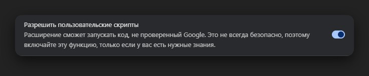

# ShikiSearcher

Добавляет на страницу аниме на [Shikimori](https://shikimori.io) кнопку **«Смотреть на …»** — с её помощью можно сразу перейти на поиск этого аниме в онлайн-кинотеатрах, не копируя название руками.

Кнопка ставится под постером, рядом с кнопкой статуса («Смотрю», «Брошено» и т.д.), и выглядит так же, как родные кнопки сайта. Переключение сервиса — по стрелке `▼` рядом с кнопкой.

## Поддерживаемые кинотеатры

- [AnimeLib](https://animelib.org)
- [AnimeGo](https://animego.org)
- [HDRezka](https://rezka.ag)
- [KinoPub](https://kino.pub)
- [YummyAnime](https://yummyanime.tv)

Список лежит в самом скрипте, менять его — одна строка на сервис.

## Установка

1. Установите расширение **Tampermonkey** для своего браузера — [Chrome](https://chromewebstore.google.com/detail/tampermonkey/dhdgffkkebhmkfjojejmpbldmpobfkfo), [Firefox](https://addons.mozilla.org/ru/firefox/addon/tampermonkey/).
2. Откройте файл скрипта: [shikisearcher.user.js](https://raw.githubusercontent.com/nokusu-n/shikisearcher/main/shikisearcher.user.js)
3. Нажмите **«Установить»** — Tampermonkey предложит установить скрипт автоматически.
4. Откройте любую страницу аниме на Shikimori — кнопка появится под постером.

Обновления приходят сами: когда выйдет новая версия, Tampermonkey предложит её установить.

### Если браузер Chrome

Начиная с Chrome 138 расширениям нужно отдельное разрешение на запуск пользовательских скриптов. Без него кнопка просто не появится.

Откройте настройки Tampermonkey и включите **«Разрешить пользовательские скрипты»**:

В Firefox ничего включать не нужно — там работает сразу.

## Как пользоваться

- **Смотреть на AnimeLib** — открывает поиск этого аниме на выбранном кинотеатре.
- **▾** — выбор кинотеатра. Он запоминается и остаётся при следующих заходах.
- В том же меню — **ru / en**: по какому названию искать, русскому или английскому. По умолчанию английское: так находится чаще.

## Про длинные названия

У некоторых аниме названия на 200+ символов, и поиск по ним промахивается. Скрипт обрезает длинные названия до 70 символов по границе слова — так кинотеатры находят нужное. Названия короче 70 символов уходят в поиск как есть.

## Совместимость

- Работает на Shikimori с кастомными темами оформления: кнопка берёт цвета и шрифт у родной кнопки статуса, поэтому не выбивается из вашей темы.
- Светлая и тёмная темы сайта поддерживаются, переключение темы на открытой странице тоже.
- Проверено в Firefox и Chrome.

## Лицензия

MIT
